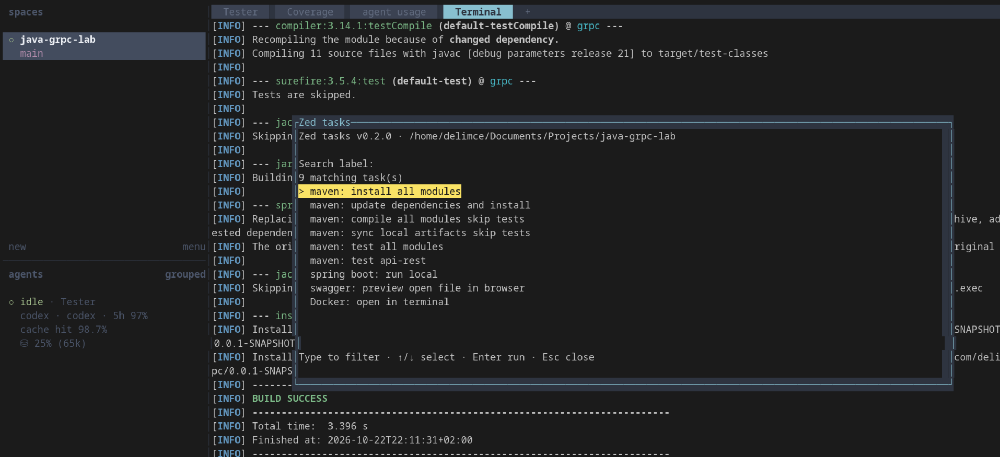

# Zed Tasks for Herdr

Pick a task from the active project's `.zed/tasks.json` and run it in the terminal pane that was focused when the picker opened. The task list is read again whenever the picker opens. Search matches words anywhere in each task's `label`, without regard to letter case.

## Preview

The picker filters project tasks by label and runs the highlighted task in the original terminal pane.



## Requirements

- Herdr 0.9 or newer on macOS or Linux
- Rust and Cargo to build from source
- A project with `.zed/tasks.json`

## Install locally

```sh
cargo build --release --locked
herdr plugin link /path/to/herdr-zed-tasks
herdr plugin action list --plugin local.zed-tasks
```

## Install from GitHub

```sh
herdr plugin install delimce/herdr-zed-tasks
herdr plugin action list --plugin local.zed-tasks
```

After updating the plugin, close any picker already open with Escape, relink the directory with `herdr plugin link`, and open the picker again. Existing popup processes do not reload the binary.

Add a shortcut to your Herdr `config.toml`:

```toml
[[keys.command]]
key = "prefix+t"
type = "plugin_action"
command = "local.zed-tasks.pick"
description = "pick a Zed task"
```

Run `herdr server reload-config` for a running session. With Herdr's default prefix, press `Ctrl+B`, then `t`. Type words from a task label, use the arrow keys to move the yellow selection, and press Enter. Once Herdr accepts the task, the picker closes automatically and the task runs in the original terminal pane, leaving its output in that pane's history. The pane must be at its shell prompt when you select the task; the picker stays open and reports an error if another program occupies it.

The plugin first checks the workspace's registered Git checkout, then the focused pane's current directory. It reads the project-local `.zed/tasks.json` from that root. It also works when the focused pane belongs to another plugin, provided Herdr has the project checkout registered as a worktree.

## Task compatibility

The runner supports `label`, `command`, `args`, `cwd`, `env`, and Zed's documented `shell` forms. It executes commands in a login shell by default. `$ZED_WORKTREE_ROOT` and `$ZED_MAIN_GIT_WORKTREE` come from the selected project. Tasks using `$ZED_FILE` or related file variables prompt for an existing file inside the project. Variables that need live editor state, such as `$ZED_SELECTED_TEXT`, are reported as unavailable.

Zed's terminal presentation settings (`use_new_terminal`, `reveal`, `hide`) are replaced by this plugin's run-in-current-pane behavior. Zed's automatic task hooks, task concurrency policy, global tasks, and extension-provided tasks are outside this version's scope.

## Security

The picker only reads `.zed/tasks.json`. It never runs a task before Enter is pressed. Before sending a command, it checks that the original pane's shell owns the foreground process group; this prevents sending the task into an editor or agent. Leave the shell input line empty before selecting a task. The plugin makes no network requests at runtime and writes no task definitions, command output, or environment variables to its own files. It does not print the task command or environment variables in the terminal. The selected task itself runs with your user account's permissions, as it does from Zed. Review task definitions before running projects you do not trust.
